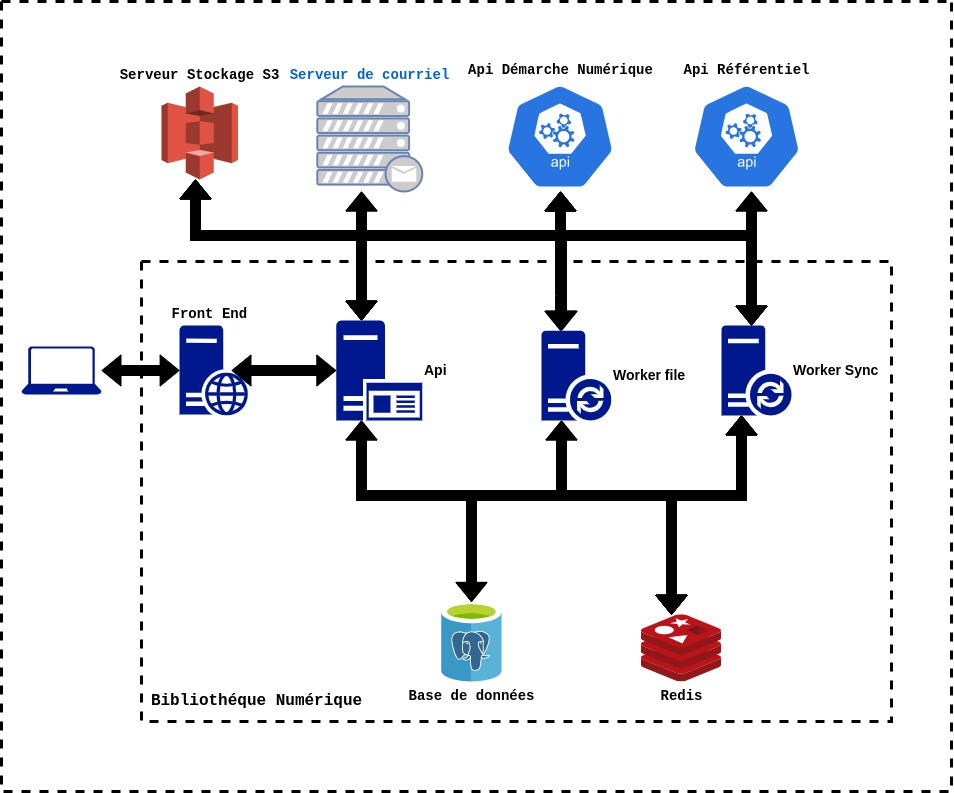
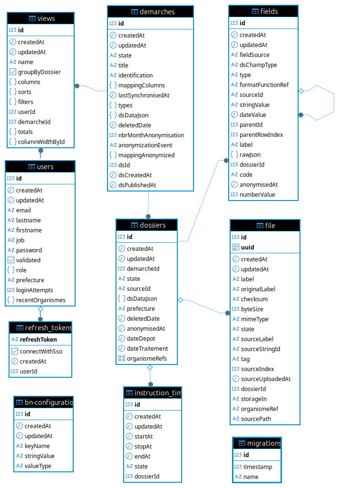

# Architecture

## Architecture du projet

Le projet est organisé sous forme de monorepo TypeScript, géré avec pnpm pour la gestion des dépendances et Turborepo pour l’orchestration des builds, des tests et des tâches partagées.

L’architecture est structurée autour de trois grands ensembles :
- apps/client : application frontend
- apps/server : application backend
- packages/shared : librairie partagée entre le frontend et le backend

## Architecture applicatif

## Modéle de données

Le schéma DER :

